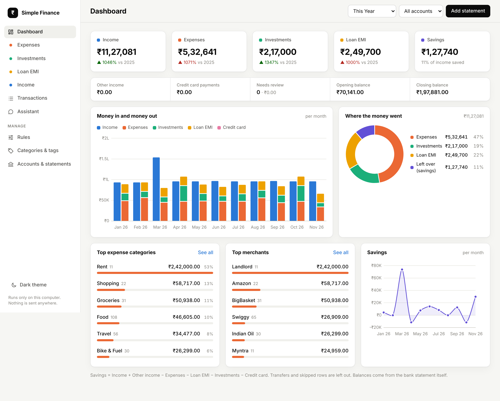
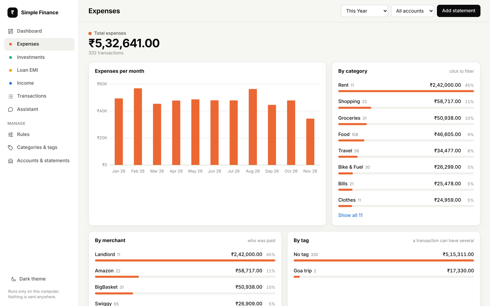
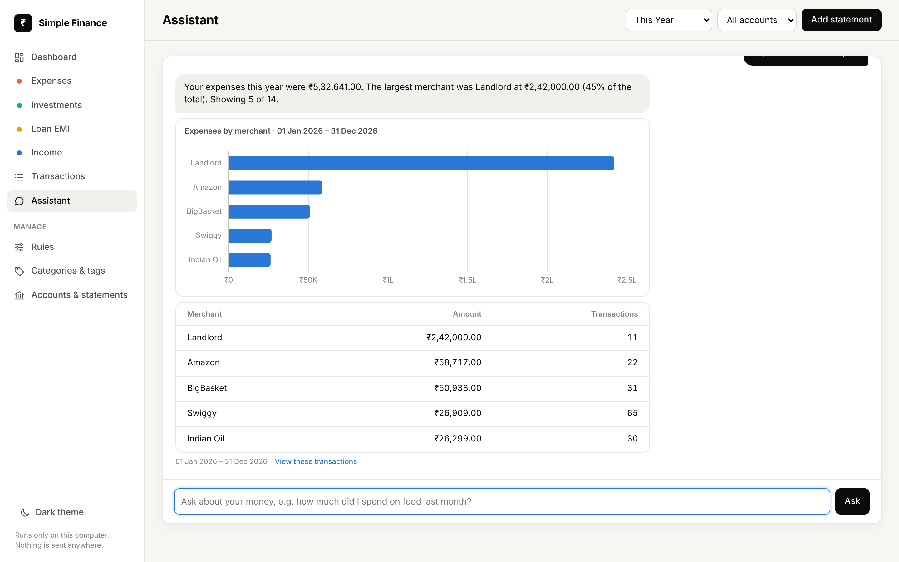

# Simple Personal Finance

A simple, private money tracker for Indian bank statements. It runs **only on your PC**: it reads your statements (CSV, Excel,
PDF), splits the money into Income, Expenses, Investments and Loan EMI, shows each one by **category, tag and merchant** with
charts, and has an offline assistant that answers questions about your money. No account, no cloud, no bank passwords.

| Expenses by category, merchant and tag | Offline assistant |
|---|---|
|  |  |

Screenshots show fictional demo data.

## Download and start (Windows, nothing to install)
1. Open the [latest release](../../releases/latest) and download **SimpleFinance.exe**.
2. Double-click it. A black window opens and your browser shows the app at `http://127.0.0.1:8765`.
   Keep the black window open while you use the app; close it to stop.
3. Windows may say *"Windows protected your PC"* because the program is not code-signed. Click **More info → Run anyway**.
   Some company laptops block unknown programs completely.

Want to look around first? Open a terminal in the download folder and run `SimpleFinance.exe --demo` to start with fictional
data (your own data is not touched).

## First steps
1. **Accounts & statements → Add account.** Use a label such as "HDFC Salary", never an account number.
2. **Add statement.** Choose the account and the file downloaded from net banking. Check the preview (you can correct any cell),
   then import. Rows that already exist are detected.
3. **Rules.** Teach the app your regular entries, for example narration contains `ZERODHA` → Investment / Stocks, or
   `HOME LOAN EMI` → Loan EMI / Home Loan. Then click **Re-apply to existing**.
4. Explore the **Dashboard**, the **Expenses / Investments / Loan EMI / Income** pages (click any bar to filter), or ask the
   **Assistant**.

## What it does
- **Dashboard:** income, expenses, investments, loan EMI and savings for any period, compared with the previous one; opening and
  closing balance from the statement; monthly charts; top categories and merchants.
- **Categories, tags and merchants:** each transaction has one category (Food, Travel, Mutual Fund, Home Loan...), any number of
  tags (for example "Goa trip") and a merchant detected from the narration (Swiggy, Amazon, Zerodha...). All editable.
- **Rules:** "narration contains TEXT" sets type, category, merchant and tags automatically. Your own edits always win; select rows
  and click **Reset to rules** to hand them back.
- **Assistant (offline, no AI service):** ask *How much did I spend on food last month?*, then follow up with *and this month?*,
  *by merchant* or *compare with September*. It uses the same numbers as the dashboard.
- **Transactions:** search, filter, bulk edit, skip rows from totals, export to CSV.
- Light and dark theme.

**Statements supported:** HDFC Bank (CSV, Excel, PDF), SBI (CSV, Excel, PDF), Canara Bank (e-passbook PDF), and any CSV or Excel
file with Date, Description, Debit, Credit and Balance columns. Scanned PDFs are not supported.

## Privacy
- Everything stays on your computer. The app only answers on `127.0.0.1` and sends nothing to the internet.
- It never asks for bank passwords, PINs or OTPs.
- Your data is one file: `%APPDATA%\SimpleFinance\finance.db`. Copy it to back up (with the app closed).
  Deleting the exe does not delete your data.

## Found a problem or have an idea?
Open an [issue](../../issues/new/choose). **Never attach a real bank statement or a screenshot with real account details**:
replace names, account numbers and reference numbers with made-up values. For import problems, a few invented rows in the same
layout as your bank's file help the most.
